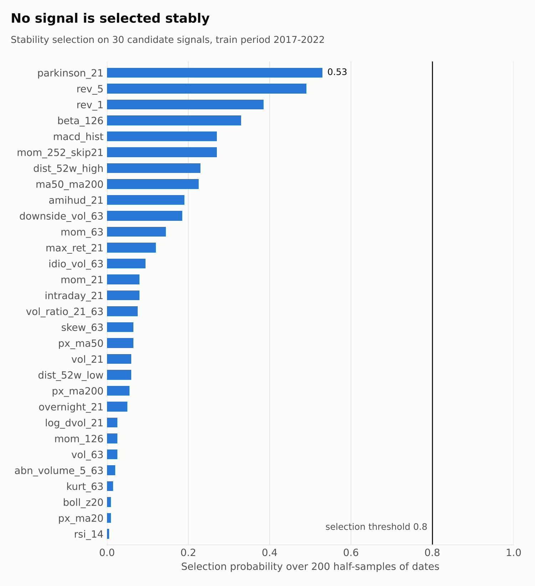
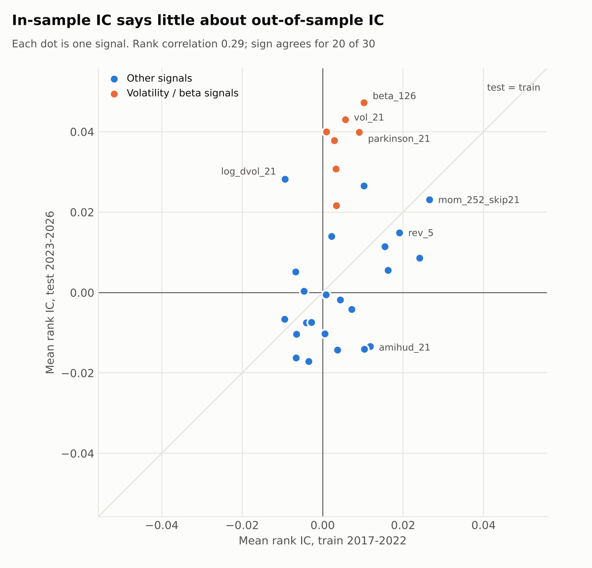
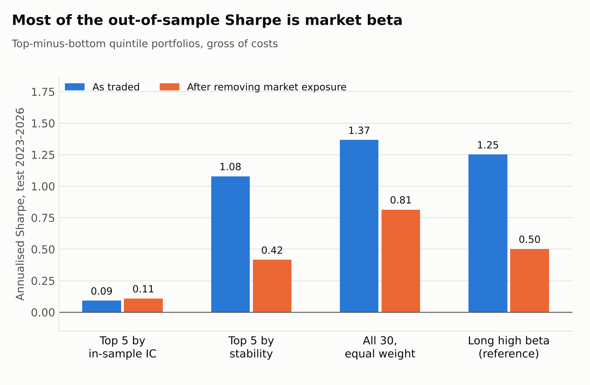

# Are common price/volume signals selected *stably*?

A small study that takes stability selection, a variable-selection method from high-dimensional statistics, and applies it to cross-sectional equity signals. The question is not "which signal has the best backtest" but "which signals would I still pick if I had seen a slightly different sample".

**Short answer: none of them.** And the out-of-sample period shows why that was the right call.

## Findings

1. **No signal is selected stably.** Across 30 candidate signals, the highest selection probability is 0.53 against a threshold of 0.80. Cross-validated LASSO agrees and selects nothing.
2. **Picking by in-sample IC does not survive.** A portfolio of the 5 signals with the best in-sample IC has an out-of-sample Sharpe of 0.09. Across all 30 signals, the rank correlation between train IC and test IC is 0.29, and the sign agrees for only 20.
3. **The one result that looked good was market beta.** Ranking by stability probability, or simply equal-weighting all 30 signals, gave out-of-sample Sharpes of 1.08 and 1.37. Regressing those returns on the market shows betas of 0.88 and 0.65, and no statistically significant alpha once the market is removed. A portfolio that is just "long high-beta stocks" does as well.



## Data and design

| | |
|---|---|
| Universe | 102 large-cap S&P 500 stocks, daily OHLCV from Yahoo Finance |
| Period | Jan 2016 to Sep 2026 (275,400 stock-days) |
| Signals | 30, from OHLCV only: momentum, reversal, trend, oscillators, volatility, beta, volume and liquidity |
| Target | 5-day forward return, demeaned across stocks on each date |
| Panel | 489 non-overlapping weekly cross-sections, 49,878 rows |
| Train / test | 2017 to 2022 (302 dates) / 2023 to Sep 2026 (187 dates) |

Choices made to keep the test honest:

- **No lookahead.** A signal on date *t* uses data up to the close of *t*. The target runs from the close of *t+1* to the close of *t+6*, so nothing is traded on the close the signal was computed from.
- **Non-overlapping targets.** Cross-sections are taken every 5 trading days, so consecutive targets share no returns.
- **Signals standardised per date.** Each signal is winsorised at the 2nd/98th percentile and z-scored within each date, so the LASSO penalty acts on a common scale.
- **The test period is used once.** Every choice of signal and sign is made on 2017 to 2022. Thresholds and K were fixed before looking at 2023 onwards and were not tuned afterwards.

## Method

**Stability selection** (Meinshausen and Bühlmann, 2010). Fit the LASSO path on 200 random half-samples and record how often each signal enters. Keep signals whose selection probability is at least 0.80. The λ range is capped so that the average number of selected signals *q* satisfies

E[false selections] ≤ q² / ((2π − 1) · p)

Here q = 4.21, π = 0.80, p = 30, which bounds the expected number of false selections at 0.98.

**The resampling unit is the date, not the row.** The 102 stocks on one date are strongly cross-sectionally dependent. Resampling rows would treat them as independent, overstate the effective sample size, and make every signal look more stable than it is.

**Baseline.** LASSO with λ chosen by 5-fold cross-validation, with folds split by date, refit on 50 bootstrap resamples of dates. It selected nothing on the full training set and nothing in the median bootstrap, but up to 7 signals in individual resamples.

## Why nothing passes: power

The standard deviation of the per-date rank IC is about 0.25, so with 302 training dates the standard error of a mean IC is about 0.25 / √302 ≈ 0.014. A signal needs a true IC of roughly 0.04 to be detected reliably. The largest in-sample IC here is 0.027. With 102 stocks and weekly data, effects of the size these signals plausibly have cannot be separated from noise, and a method that controls false selections correctly declines to select.

## Out of sample



Composite = equal-weight average of the chosen signals, each signed by its train IC. Scored on 2023 to 2026 by rank IC and by a top-minus-bottom quintile portfolio, gross of costs.

| Rule | Signals | Test IC | IC t-stat | L/S Sharpe |
|---|---|---|---|---|
| Top 3 by in-sample IC | 3 | 0.016 | 0.87 | 0.20 |
| Top 5 by in-sample IC | 5 | 0.009 | 0.53 | 0.09 |
| Top 10 by in-sample IC | 10 | 0.010 | 0.59 | 0.09 |
| Top 3 by stability probability | 3 | 0.023 | 1.46 | 0.72 |
| Top 5 by stability probability | 5 | 0.042 | 2.04 | 1.08 |
| Top 10 by stability probability | 10 | 0.034 | 1.68 | 1.06 |
| All 30, equal weight | 30 | 0.036 | 2.05 | 1.37 |

Read at face value, stability ranking beats IC ranking. It should not be read at face value. The six signals with the highest out-of-sample IC are all volatility or beta measures (orange in the figure above), and their in-sample t-statistics were all below 0.6. Nothing in the training data pointed to them.

## The beta check

The long-short portfolios are dollar-neutral, not beta-neutral. A composite that loads on volatility and beta is long high-beta stocks and short low-beta stocks, so it earns the market premium when the market rises. Over the test period the equal-weight universe returned 19.8% a year with a Sharpe of 1.51.

Regressing each long-short return series on the market return over the same windows:

| Rule | L/S Sharpe | Beta to market | Alpha t-stat | Sharpe after hedging |
|---|---|---|---|---|
| Top 5 by in-sample IC | 0.09 | −0.02 | 0.20 | 0.11 |
| Top 5 by stability probability | 1.08 | 0.88 | 0.78 | 0.42 |
| All 30, equal weight | 1.37 | 0.65 | 1.53 | 0.81 |
| Long high beta (reference) | 1.25 | 1.27 | 0.94 | 0.50 |



No rule has a statistically significant alpha. The stability-ranked portfolio happened to contain `parkinson_21` and `beta_126`; the IC-ranked one contained no volatility signal. The gap between them is whether the rule happened to be long beta in a rising market, not evidence that one ranking is better.

## Limitations

- **Survivorship bias.** The universe is today's large caps. High-volatility winners are included by construction and high-volatility losers have dropped out, which flatters volatility, beta and momentum signals. This is acceptable for a study of selection stability and is a reason not to quote any return figure here as achievable.
- **Hedged Sharpes are optimistic.** The hedge ratio is estimated on the same test data it is applied to.
- **One test period, one regime.** 187 weekly observations, almost all of it a rising market.
- **No costs.** Reversal and short-horizon signals in particular would lose much of their gross return to turnover.
- **Low power by design.** 102 stocks is a small cross-section. The natural extension is the full S&P 500 with point-in-time constituents, with the same thresholds fixed in advance.

## Reproduce

```
pip install -r requirements.txt
python scripts/01_download_prices.py
python scripts/02_build_signals.py
python scripts/03_stability_selection.py
python scripts/04_out_of_sample.py
python scripts/05_beta_check.py
python scripts/06_figures.py
```

Results depend on the download date, since Yahoo adjusts historical prices for later dividends and splits.

## Reference

Meinshausen, N. and Bühlmann, P. (2010). Stability selection. *Journal of the Royal Statistical Society: Series B*, 72(4), 417–473.
